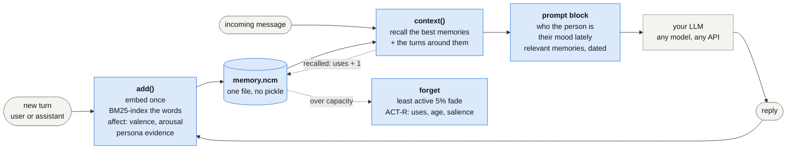
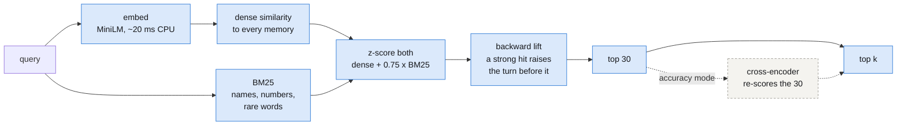
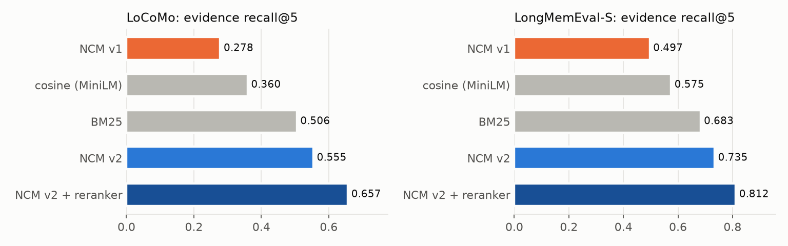
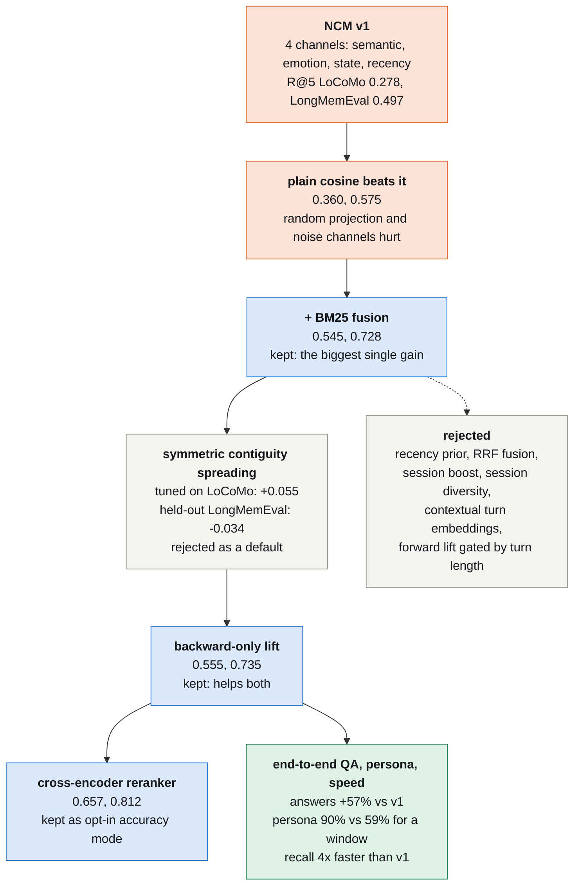

# NCM: Native Cognitive Memory

Long-term memory for conversational AI. It remembers what was said, finds what
is relevant, knows who the person is, notices how they feel, and slowly forgets
what stopped mattering. One Python object, numpy plus any embedding model, one
file on disk.

```python
from ncm import Memory

mem = Memory("alice.ncm")                       # loads if the file exists
mem.add("I adopted a beagle called Max", speaker="user")
mem.add("Max! Great name. How old is he?", speaker="assistant")

print(mem.context("what's my dog called?"))     # paste this into your LLM prompt
mem.save()
```

```
What you know about user:
- I adopted a beagle called Max
Their mood lately: positive

Relevant memories (oldest first):
[11 October 2026, 09:12] user: I adopted a beagle called Max
[11 October 2026, 09:12] assistant: Max! Great name. How old is he?
```

## Why NCM

- **Finds the right memory.** Hybrid dense + keyword ranking with a
  conversational contiguity prior. On two public long-conversation benchmarks it
  retrieves the evidence **1.5-2x as often as NCM v1** and **28-54% more often
  than plain vector search**. Add one line, `Memory(reranker=True)`, for an
  accuracy mode that reaches **2.4x v1** ([results](docs/RESULTS.md)).
- **Better answers from the same LLM.** On LoCoMo, a 3B local model answers with
  F1 **0.289** from NCM's memories, against **0.214** from vector
  search and **0.184** from NCM v1.
- **Gives a character a person to remember.** Asked which of two statements is true
  of someone after five sessions, a 3B model is right 90% of the time with NCM's
  `context()`, 87% with plain vector search and 59% with the last 10 turns a
  sliding-window bot keeps.
  `persona()` distils who the user is from their own statements, `mood()` tracks the
  emotional tone, and emotional memories fade more slowly (ACT-R activation plus salience).
- **Small and fast.** Pure numpy at query time, no LLM calls inside the memory.
  Recall takes 0.6 ms at 1k memories and 12 ms at 100k
  on a laptop CPU. Default embedder: all-MiniLM-L6-v2 (22M parameters).
- **Safe to persist.** One `.ncm` file, atomic writes, no pickle. Old v1 files
  import with `ncm.legacy.import_v1`.

## Install

```bash
pip install -e ".[embed]"        # numpy + sentence-transformers
```

Without the `embed` extra NCM needs only numpy; pass your own embedder (below).

## Use it with an LLM

NCM never calls a model itself. It hands you a prompt block; your model writes the reply.

```python
mem = Memory("user-42.ncm")

def chat(user_msg):
    system = "You are Mira, a warm companion.\n\n" + mem.context(user_msg, self_name="assistant")
    reply = llm(system=system, user=user_msg)          # any model, any API
    mem.add_many([user_msg, reply], speakers=["user", "assistant"])
    mem.save()
    return reply
```

OpenAI-style message lists go in directly: `mem.add_messages(messages)`.

A complete local example, a character that remembers you across sessions on
Ollama, is in [`examples/chat.py`](examples/chat.py):

```bash
ollama pull qwen2.5:3b
python examples/chat.py
```

## How it works

NCM sits between your app and your LLM. Every turn goes in once; before each
reply, `context()` hands the model what it should remember.



Inside `recall()`, ranking is about relevance only. Emotion and age never change
what is relevant; they only decide what is kept when the store is full.



What each memory carries:

| field | from | used for |
|---|---|---|
| text, speaker, time, session | the turn | rendering, speaker filter, contiguity |
| 384-d vector | the embedder, once | dense similarity, persona diversity |
| BM25 postings | the words | keyword match |
| valence, arousal | probe on the vector | `mood()`, salience |
| salience | affect, or `meta={"salience": ...}` | slower forgetting |
| persona evidence | first-person statement patterns | `persona()` |
| uses | each recall in `context()` | slower forgetting |

Every piece was kept only if it measured well. What was dropped, and why, is in
[docs/HISTORY.md](docs/HISTORY.md).

## API

| call | does |
|---|---|
| `Memory(path=None, embedder=None, config=None, reranker=None)` | open or create a memory; `reranker=True` turns on accuracy mode |
| `add(text, speaker="user", time=None, meta=None)` | store one utterance, returns its id |
| `add_many(texts, speakers, times, metas)` | batched, one embedding call |
| `add_messages(messages)` | OpenAI-style `[{"role", "content"}]` |
| `new_session()` | mark a conversation boundary (otherwise: 30 min of silence) |
| `recall(query, k=5, speaker=None, reinforce=False)` | the k most relevant memories, as `Recalled` objects |
| `context(query, k=4, persona_of="user", window=1, self_name=None)` | prompt-ready block: persona, mood, the k best memories with their neighbouring turns |
| `persona(mem, speaker="user", k=6)` (in `ncm.persona`) | statements that describe the speaker |
| `mood(speaker=None)` | `{"valence", "arousal", "label"}` of recent statements |
| `forget(id or ids)`, `get(id)`, `all()`, `len(mem)` | housekeeping |
| `save(path=None)`, `Memory.load(path)` | one file, atomic |

**Embedders.** Default is `sentence-transformers/all-MiniLM-L6-v2`. Pass a model
name (`Memory(embedder="BAAI/bge-small-en-v1.5")`) or any callable
`fn(list[str]) -> array (n, d)`, such as an API client. An object with a `name`
attribute and `__call__(texts, query=False)` can embed queries differently.

**Accuracy mode.** `Memory(reranker=True)` re-scores the top 30 hits with a small
cross-encoder (ms-marco-MiniLM-L-6-v2, 22M parameters): recall@5 +0.10 on LoCoMo
and +0.08 on LongMemEval, for ~0.1-0.2 s per query on a laptop GPU. Any
`fn(query, texts) -> scores` works as a reranker too.

**Config** (`ncm.Config`):

| field | default | meaning |
|---|---|---|
| `lexical_weight` | 0.75 | BM25 weight next to dense similarity |
| `lift_previous` | 0.75 | a hit lifts the turn before it (its question) |
| `lift_next` | 0.0 | a hit lifts the turns after it; 0.75 helps dialogue between two people (LoCoMo), hurts assistant chat (LongMemEval) |
| `lift_width` | 1.0 | how far the lift reaches, in turns |
| `session_gap` | 1800 | seconds of silence that start a new session |
| `max_items` | 0 | capacity; 0 = unlimited |
| `rerank_top` | 30 | with a reranker: how many first-stage hits it re-scores |
| `decay` | 0.5 | ACT-R decay for forgetting |

## Results

Two public long-conversation benchmarks, a personalisation test, and a speed test.
Every number comes from `bench/`; confidence intervals and method are in
[docs/RESULTS.md](docs/RESULTS.md).

**Retrieval:** how often the turn holding the answer is in the top 5 (recall@5).
Same embeddings (MiniLM) for every row.

| | LoCoMo (1,531 q) | LongMemEval-S (479 q) |
|---|---|---|
| NCM v1 | 0.278 | 0.497 |
| plain vector search (cosine) | 0.360 | 0.575 |
| BM25 keywords | 0.506 | 0.683 |
| **NCM v2** | **0.555** | **0.735** |
| **NCM v2 + reranker** (accuracy mode) | **0.657** | **0.812** |



**Answers:** a local qwen2.5:3b reads each system's memories and answers (token F1).
These runs used an Ollama install with a 4-bit KV cache, which corrupts this model's
output and lowers every score; the clean head-to-head above supersedes the absolute
numbers, and the ordering (v1 below plain vector search below v2) holds there too.

| memories given | LoCoMo (400 q) | LongMemEval (200 q) |
|---|---|---|
| none | 0.043 | 0.095 |
| NCM v1 | 0.184 | 0.217 |
| plain vector search | 0.214 | 0.224 |
| **NCM v2 `context()`** | **0.289** | **0.293** |

**Personalisation:** after five Multi-Session Chat sessions, which of two statements
is true of the speaker (480 pairs, chance 0.5)?

| what the model is given | accuracy |
|---|---|
| no memory | 0.529 |
| the last 10 turns (a sliding-window bot) | 0.588 |
| plain vector search | 0.867 |
| NCM v2 `recall()` | 0.869 |
| **NCM v2 `context()`** | **0.900** |

NCM's retrieval alone ties vector search; the persona block in `context()` adds +0.033
(p 0.03, borderline once corrected for two comparisons). Details in
[docs/RESULTS.md](docs/RESULTS.md).

**Speed:** recall latency p50 on a laptop CPU, NCM's own cost (the query embedding
adds ~21 ms on CPU).

| memories | 1,000 | 10,000 | 100,000 | 1,000,000 |
|---|---|---|---|---|
| NCM v1 | 0.92 ms | 5.6 ms | 49 ms | |
| **NCM v2** | **0.56 ms** | **1.3 ms** | **11.6 ms** | 117 ms |

## How NCM compares to other memory systems

Thirteen ways of giving an AI memory, run head to head on the same conversations, the
same questions and the same local LLM (qwen2.5:3b), with what each costs. Full tables,
code and raw outputs: [comparisons/](comparisons/README.md).

| system | answer F1 | to store a memory | LLM calls to store 788 turns | to fetch context | prompt to the LLM |
|---|---|---|---|---|---|
| **NCM v2 + reranker** | **0.436** | 5 ms | 0 | 187 ms | ~510 tokens |
| **NCM v2 `context()`** | **0.406** | 5 ms | 0 | 7 ms | ~490 tokens |
| vector RAG, bge-base embedder | 0.395 | 21 ms | 0 | 33 ms | ~430 tokens |
| vector RAG → bge-reranker-base | 0.378 | 4 ms | 0 | 1,166 ms | ~460 tokens |
| hybrid search (BM25 + vectors, RRF) | 0.359 | 4 ms | 0 | 8 ms | ~380 tokens |
| full history in the prompt | 0.344 | - | 0 | - | ~17,700 tokens |
| vector RAG, MiniLM embedder | 0.337 | 3 ms | 0 | 7 ms | ~390 tokens |
| Mem0 (open-source, local LLM) | 0.291 | 4.2 s | 395 | 57 ms | ~360 tokens |
| summary memory (LLM per session) | 0.280 | 190 ms | 38 | 0 ms | ~2,800 tokens |
| last 20 turns only | 0.072 | - | 0 | - | ~840 tokens |

NCM is in the most accurate group at the bottom of the cost range. Its lead over a
well-chosen vector RAG (bge-base) is within the noise on these 230 questions; its lead
over full-history prompting, hybrid search, Mem0 on a local LLM and summary memory is
significant. Published vendor numbers (GPT-4-class models, not comparable) are listed
alongside in [comparisons/](comparisons/README.md#3-published-numbers-from-the-vendors-not-measured-here).

## How v2 was built: the experiments

v2 was not designed up front. Each component was proposed, measured on both
benchmarks, and kept only if it held on both. The path:



| experiment | LoCoMo R@5 | LongMemEval R@5 | decision |
|---|---|---|---|
| BM25 fused with dense (vs dense only) | +0.19 | +0.15 | **kept** |
| backward lift (vs none) | +0.010 | +0.007 (nDCG +0.020, MRR +0.031) | **kept** |
| cross-encoder reranker over top 30 | +0.102 | +0.077 | **opt-in** (costs 30-230 ms) |
| forward lift too ("dialogue mode") | +0.039 | -0.138 | opt-in for two-person transcripts |
| bge-small instead of MiniLM | +0.010 | +0.024 | optional (1.8x encoding cost) |
| recency prior | +0.000 | +0.003 | rejected |
| reciprocal rank fusion instead of z-scores | -0.085 | -0.030 | rejected |
| session-max boost | +0.035 | -0.022 | rejected |
| session-diverse top-k | -0.015 | -0.001 | rejected |
| contextual turn embeddings | +0.014 | -0.008 | rejected |
| emotion and state as ranking channels (v1) | | | removed: no retrievable signal |
| affect probe (EmoBank + GoEmotions) vs v1 tracker | valence r 0.42 -> 0.62, arousal r 0.10 -> 0.44 | | **kept** for mood and salience |

The tuning protocol, ablations with confidence intervals, and the end-to-end and
persona experiments are written up in [docs/RESULTS.md](docs/RESULTS.md).

## Reproduce

```bash
uv venv && uv pip install -e ".[dev]"
uv pip install torch --index-url https://download.pytorch.org/whl/cu124   # GPU, optional
pytest                                            # seconds, no model download
python -m bench.retrieval --dataset locomo        # dataset paths: bench/data.py
python -m bench.retrieval --dataset longmemeval
python -m bench.v1_baseline --dataset locomo      # needs the v1 code: see the script
python -m bench.qa                                # needs Ollama + qwen2.5:3b
python -m bench.persona
python -m bench.speed && python -m bench.plots
```

## Limits

- Benchmarks are English, and the persona and question detectors are English regexes.
- The affect probe reads valence well (r 0.62 against human ratings, AUC 0.91 on
  Reddit comments) and arousal moderately (r 0.44). Topic words pull it: when the
  feeling and the topic disagree ("thrilled about the funeral"), it gets the sign wrong
  about one time in nine. Treat `mood()` as a soft, relative signal.
- Contradictions are not resolved inside the memory: `context()` dates (in UTC) and
  orders memories so the reader can tell which statement is newer.
- More context is not better for small models: with a 3B reader, fewer and better
  memories beat more of them.

## License and history

NCM is by Thanniru Sai Teja. What v1 was and how v2 differs:
[docs/HISTORY.md](docs/HISTORY.md), [CHANGELOG.md](CHANGELOG.md).
