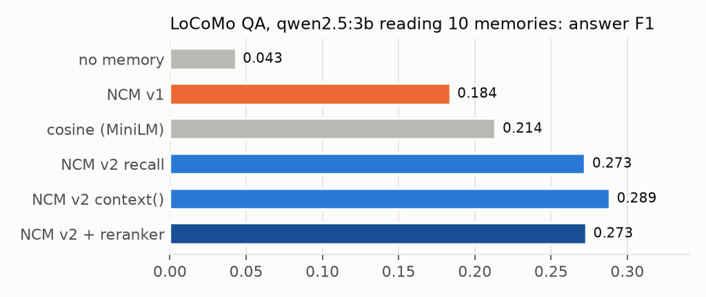
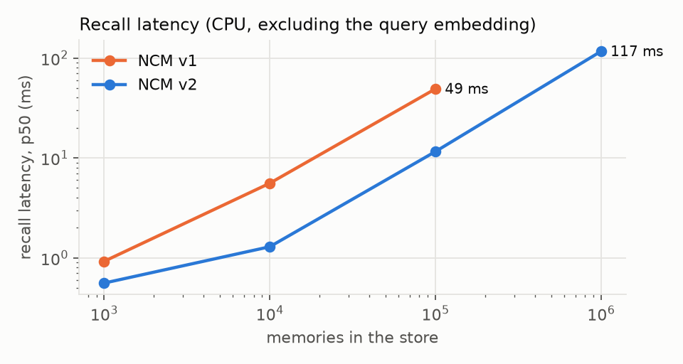

# NCM: Native Cognitive Memory

Long-term memory for conversational AI. It remembers what was said, finds what
is relevant, knows who the person is, notices how they feel, and slowly forgets
what stopped mattering. One Python object, numpy plus any embedding model, one
file on disk.

```python
from ncm import Memory

mem = Memory("alice.ncm")                       # loads if the file exists
mem.add("I adopted a beagle called Max", speaker="user")
mem.add("Max! Great name. How old is he?", speaker="assistant")

print(mem.context("what's my dog called?"))     # paste this into your LLM prompt
mem.save()
```

```
What you know about user:
- I adopted a beagle called Max
Their mood lately: positive

Relevant memories (oldest first):
[11 October 2026, 09:12] user: I adopted a beagle called Max
[11 October 2026, 09:12] assistant: Max! Great name. How old is he?
```

## Why NCM

- **Finds the right memory.** Hybrid dense + keyword ranking with a
  conversational contiguity prior. On two public long-conversation benchmarks it
  retrieves the evidence **1.5-2x as often as NCM v1** and **28-54% more often
  than plain vector search** ([results](docs/RESULTS.md)).
- **Better answers from the same LLM.** On LoCoMo, a 3B local model answers with
  F1 **RESULT_QA_V2** from NCM's memories, against **RESULT_QA_DENSE** from vector
  search and **RESULT_QA_V1** from NCM v1.
- **Gives a character a person to remember.** `persona()` distils who the user is
  from their own statements, `mood()` tracks the emotional tone, and emotional
  memories fade more slowly (ACT-R activation plus salience).
- **Small and fast.** Pure numpy at query time, no LLM calls inside the memory.
  Recall takes RESULT_SPEED_1K ms at 1k memories and RESULT_SPEED_100K ms at 100k
  on a laptop CPU. Default embedder: all-MiniLM-L6-v2 (22M parameters).
- **Safe to persist.** One `.ncm` file, atomic writes, no pickle. Old v1 files
  import with `ncm.legacy.import_v1`.

## Install

```bash
pip install -e ".[embed]"        # numpy + sentence-transformers
```

Without the `embed` extra NCM needs only numpy; pass your own embedder (below).

## Use it with an LLM

NCM never calls a model itself. It hands you a prompt block; your model writes the reply.

```python
mem = Memory("user-42.ncm")

def chat(user_msg):
    system = "You are Mira, a warm companion.\n\n" + mem.context(user_msg, self_name="assistant")
    reply = llm(system=system, user=user_msg)          # any model, any API
    mem.add_many([user_msg, reply], speakers=["user", "assistant"])
    mem.save()
    return reply
```

OpenAI-style message lists go in directly: `mem.add_messages(messages)`.

A complete local example, a character that remembers you across sessions on
Ollama, is in [`examples/chat.py`](examples/chat.py):

```bash
ollama pull qwen2.5:3b
python examples/chat.py
```

## How it works

```
 add(text, speaker, time)                     recall(query) / context(query)
 ------------------------                     ------------------------------
 embed "speaker: text"  (1 model call)        embed query    (1 model call)
 BM25-index the tokens                        dense   = E @ q             \
 affect probe on the vector -> valence,       lexical = BM25(query)        } z-score, sum
   arousal -> salience                        lift: a strong hit raises    /
 new session after 30 min of silence            the turn just before it
 exact repeat? reinforce, don't store         top-k -> add neighbouring turns,
                                                persona, mood; date and sort
 forgetting (only when max_items is set): ACT-R activation
   ln((uses+1)/(1-d)) - d ln(age) + salience; the least active 5% fade
```

Every piece was kept only if it measured well. What was dropped, and why, is in
[docs/HISTORY.md](docs/HISTORY.md).

## API

| call | does |
|---|---|
| `Memory(path=None, embedder=None, config=None)` | open or create a memory |
| `add(text, speaker="user", time=None, meta=None)` | store one utterance, returns its id |
| `add_many(texts, speakers, times, metas)` | batched, one embedding call |
| `add_messages(messages)` | OpenAI-style `[{"role", "content"}]` |
| `new_session()` | mark a conversation boundary (otherwise: 30 min of silence) |
| `recall(query, k=5, speaker=None, reinforce=False)` | the k most relevant memories, as `Recalled` objects |
| `context(query, k=8, persona_of="user", window=1, self_name=None)` | prompt-ready block |
| `persona(mem, speaker="user", k=6)` (in `ncm.persona`) | statements that describe the speaker |
| `mood(speaker=None)` | `{"valence", "arousal", "label"}` of recent statements |
| `forget(id or ids)`, `get(id)`, `all()`, `len(mem)` | housekeeping |
| `save(path=None)`, `Memory.load(path)` | one file, atomic |

**Embedders.** Default is `sentence-transformers/all-MiniLM-L6-v2`. Pass a model
name (`Memory(embedder="BAAI/bge-small-en-v1.5")`) or any callable
`fn(list[str]) -> array (n, d)`, such as an API client. An object with a `name`
attribute and `__call__(texts, query=False)` can embed queries differently.

**Config** (`ncm.Config`):

| field | default | meaning |
|---|---|---|
| `lexical_weight` | 0.75 | BM25 weight next to dense similarity |
| `lift_previous` | 0.75 | a hit lifts the turn before it (its question) |
| `lift_next` | 0.0 | a hit lifts the turns after it; 0.75 helps dialogue between two people (LoCoMo), hurts assistant chat (LongMemEval) |
| `lift_width` | 1.0 | how far the lift reaches, in turns |
| `session_gap` | 1800 | seconds of silence that start a new session |
| `max_items` | 0 | capacity; 0 = unlimited |
| `decay` | 0.5 | ACT-R decay for forgetting |

## Results

Full tables, confidence intervals and method: [docs/RESULTS.md](docs/RESULTS.md).






## Reproduce

```bash
uv venv && uv pip install -e ".[dev]"
uv pip install torch --index-url https://download.pytorch.org/whl/cu124   # GPU, optional
pytest                                            # seconds, no model download
python -m bench.retrieval --dataset locomo        # dataset paths: bench/data.py
python -m bench.retrieval --dataset longmemeval
python -m bench.v1_baseline --dataset locomo      # needs the v1 code: see the script
python -m bench.qa                                # needs Ollama + qwen2.5:3b
python -m bench.persona
python -m bench.speed && python -m bench.plots
```

## Limits

- Benchmarks are English, and the persona and question detectors are English regexes.
- The affect probe reads valence well (r 0.62 against human ratings on EmoBank)
  and arousal moderately (r 0.44). It was trained on news and fiction, so treat
  `mood()` as a soft signal.
- Contradictions are not resolved inside the memory: `context()` dates (in UTC) and
  orders memories so the reader can tell which statement is newer.
- More context is not better for small models: with a 3B reader, fewer and better
  memories beat more of them.

## License and history

NCM is by Thanniru Sai Teja. What v1 was and how v2 differs:
[docs/HISTORY.md](docs/HISTORY.md), [CHANGELOG.md](CHANGELOG.md).
